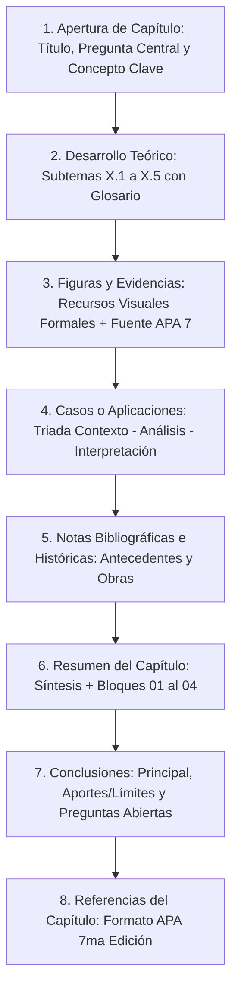
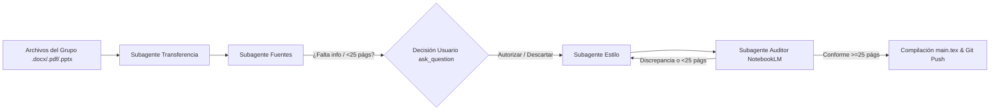

# AGENTS.md: Directrices Editoriales, Cláusula NotebookLM y Manual de Subagentes Especializados

Este documento constituye la **constitución editorial, operativa y metodológica** para cualquier agente de inteligencia artificial (o colaborador humano) que participe en la redacción, maquetación, corrección, auditoría y compilación del libro académico de la **Universidad Nacional Mayor de San Marcos (UNMSM)**.

---

## 1. Identidad Institucional y Propósito de la Obra

* **Título General de la Obra:** *Inteligencia Artificial Aplicada: Fundamentos, Métodos y Validación Científica*
* **Filiación Académica:** Universidad Nacional Mayor de San Marcos, Facultad de Ciencias Matemáticas.
* **Asignatura:** Inteligencia Artificial Aplicada (Semestre 2026-I / 2026-II).
* **Docente Titular:** Dra. Frida Mereyda Lopez Cordova.
* **Naturaleza Editorial:** Libro monográfico digital (E-book) estructurado en capítulos temáticos exhaustivos aportados por los grupos de investigación de la asignatura (Capítulos 1 al 13).
* **Capítulo Benchmark Canónico:** El **Capítulo 12** (elaborado a partir de la investigación del Grupo 13) constituye el modelo patrón de calidad, densidad argumental, rigor metodológico, balance visual y extensión académica. Todo nuevo capítulo debe estructurarse y estilizarse emulando dicho estándar.

---

## 2. Cláusula de Grounding Estricto tipo NotebookLM

> [!IMPORTANT] Principio Rector: Comportamiento NotebookLM (Closed-Domain Grounding)
> Todo agente que opere en este repositorio debe comportarse de forma análoga a **NotebookLM**:
> 1. **Extracción y Síntesis Fundamentada al 100%:** Toda afirmación conceptual, dato numérico, porcentaje, cita histórica, procedimiento algorítmico o conclusión debe derivar directa y demostrablemente de los documentos provistos por los grupos (`.docx`, `.pdf`, `.pptx`, `.tex`) o de las fuentes científicas primarias indexadas en la carpeta `referencias/`.
> 2. **Prohibición Absoluta de Alucinación o Extrapolación Libre:** Está terminantemente prohibido inventar o asumir estadísticas, citas bibliográficas, autores ficticios, casos de éxito no verificados o formulaciones matemáticas no presentes en las fuentes.
> 3. **Gestión de Vacíos Informativos:** Si el documento entregado por un grupo omite o desarrolla débilmente una de las secciones canónicas (p. ej. notas históricas o caso práctico), el agente **no debe fabricar contenido**. En su lugar, el `capitulo-fuentes` buscará la literatura científica real correspondiente a la temática del grupo y activará un **punto de decisión interactivo (`ask_question`)** para que el usuario autorice explícitamente su extensión o decida mantenerla concisa con lo entregado.

---

## 3. Invariante de Extensión Mínima: Al Menos 25 Páginas por Capítulo

> [!CAUTION] Regla Mandatoria de Extensión: $\ge 25$ Páginas por Capítulo
> Cada capítulo que forme parte del libro final compilado debe tener una **extensión mínima de 25 páginas** en el formato tipográfico oficial (A4, márgenes de 2.5 cm, tipografía 12pt).
> 
> * **Prohibición de Resúmenes Superficiales:** Un capítulo no es un resumen ejecutivo ni una ficha técnica; es una monografía exhaustiva con densidad académica profunda.
> * **Tratamiento de Monografías Extensas (ej. Grupo 13, 46 páginas):** El agente debe volcar y articular la totalidad de las partes, subtemas, tablas, figuras vectoriales, listados de código y casos de estudio originales. Está terminantemente prohibido compactar una monografía de 40+ páginas en un resumen de 5 a 7 páginas.
> * **Tratamiento de Entregas Breves (ej. Diapositivas o borradores cortos):** Cuando un grupo haya entregado un material sintético (ej. presentación PPTX de 10-15 diapositivas o documento breve de 5 páginas), los subagentes deben investigar y expandir formalmente el contenido apoyándose en la literatura científica arbitrada del tema hasta alcanzar el umbral de **al menos 25 páginas**, previa autorización del usuario mediante `ask_question`.
> * **Densidad Académica sin Relleno Artificial:** La extensión de 25+ páginas debe alcanzarse mediante sustancia científica real:
>   1. Desglose analítico multinivel ($X.1, X.2, X.3, \dots, X.5$).
>   2. Tablas analíticas comparativas multidimensionales.
>   3. Diagramas arquitectónicos y esquemas metodológicos en TikZ nativo.
>   4. Fragmentos de código comentados con auditoría de seguridad (código vulnerable vs. refactorizado).
>   5. Casos de estudio empíricos completos estructurados en la tríada: Contexto, Análisis/Implementación y Métricas/Interpretación.
>   6. Notas históricas y antecedentes de autores clásicos con citas secundarias formales.

---

## 4. Invariantes Técnicos y Estilo Visual Institucional en LaTeX

El repositorio utiliza LaTeX con motor de compilación `pdflatex` o `xelatex`. Ningún agente modificará arbitrariamente los siguientes parámetros maestros definidos en `main.tex`:

### Formato Geométrico y Tipográfico
* **Dimensiones de Página:** Formato A4 vertical (`21.0 cm × 29.7 cm`).
* **Márgenes:** Simétricos de `top=2.5cm, bottom=2.5cm, left=2.5cm, right=2.5cm`.
* **Tipografía de Lectura y Títulos Serif:** `tgtermes` (equivalente de alta fidelidad tipográfica a *Nimbus Roman* / *Times New Roman*).
* **Tipografía Sans-Serif (Metadatos, Etiquetas y Cajas):** `helvet` (equivalente exacto a *Nimbus Sans* / *Helvetica*).
* **Microtipografía:** Paquete `microtype` obligatorio para garantizar una justificación perfecta y mitigar palabras huérfanas o particiones silábicas rígidas.
* **Espaciado de Listas (`enumitem`):** Todas las listas (`itemize`, `enumerate`) deben respetar `topsep=0.3em, itemsep=0.25em, parsep=0pt, leftmargin=1.5em` para evitar saltos de página involuntarios y garantizar compacidad visual.

### Paleta Cromática Institucional (UNMSM)
```latex
\definecolor{unmsm_red}{RGB}{133, 45, 58}      % Color vino institucional #852D3A
\definecolor{unmsm_darkred}{RGB}{165, 42, 53}  % Granate San Marcos #A52A35
\definecolor{bg_marfil}{RGB}{251, 247, 239}    % Fondo marfil oficial #FBF7EF
\definecolor{bg_arena}{RGB}{237, 225, 207}     % Fondo arena de soporte #EDE1CF
\definecolor{unmsm_gray}{RGB}{106, 98, 90}     % Gris cálido para lectura secundaria #6A625A
\definecolor{unmsm_gold}{RGB}{200, 190, 176}   % Dorado suave / separadores #C8BEB0
```

### Encabezados y Pies de Página (`fancyhdr`)
* **Encabezado Izquierdo:** `\textcolor{unmsm_red}{\small\sffamily\textbf{\leftmark}}` (sección activa corta).
* **Encabezado Derecho:** `\textcolor{unmsm_red}{\small\sffamily Inteligencia Artificial Aplicada \quad|\quad \textbf{\thepage}}`.
* **Línea de Encabezado:** Regla vino institucional de 0.6 pt (`unmsm_red`).
* **Pie de Página Institucional:** Sobrio y sin duplicar el número de página:
  * Margen izquierdo: *Universidad Nacional Mayor de San Marcos*.
  * Margen derecho: *Facultad de Ciencias Matemáticas*.

---

## 5. Anatomía Canónica de Cada Capítulo (7 Bloques + Referencias)

Todo capítulo integrado al libro debe replicar rigurosamente la secuencia de **7 componentes pedagógicos** inspirados en la identidad visual de San Marcos:



### Especificación de los Bloques Requeridos:

1. **Apertura de Capítulo:**
   * Título numerado con versión corta para cornisas (`\section[Título Corto]{Título Completo del Capítulo}`).
   * Recuadro beige superior (`\begin{cajabeige}`) con la **Pregunta Central del Capítulo** y el **Objetivo de Aprendizaje**.
   * Bloque lateral destacado (`\textoside{...}{CONCEPTO CLAVE\\...}`) con la definición medular del tema.
   * **Subtema X.1:** Introducción teórica, justificación contextual y antecedentes directos con citas APA 7.

2. **Desarrollo Teórico y Conceptual Extenso (Subtemas X.2, X.3, X.4, X.5):**
   * Explicación técnica detallada de cada vertiente metodológica, algoritmos o arquitecturas.
   * Cajas de glosario técnico o notas al pie para términos especializados.
   * Desglose jerárquico profundo en apartados específicos (`\subsubsection` y `\paragraph`).

3. **Figuras y Evidencias Visuales Múltiples:**
   * Recursos visuales de alto impacto: diagramas de arquitectura en TikZ, esquemas metodológicos, gráficos cuantitativos y tablas comparativas formales.
   * Rótulo formal APA 7: `\textbf{Figura X.Y.}` en negrita, seguido del *Título Descriptivo* en cursiva en línea independiente.
   * Nota o fuente al pie del elemento visual (`\scriptsize \textbf{Fuente:} ...` o `\scriptsize \textbf{Nota.} Adaptado de...`).

4. **Casos Prácticos Aplicados:**
   * Cada caso debe dividirse explícitamente en la tríada metodológica:
     * `\subsubsection*{Contexto:}` Descripción del escenario real, datos y condiciones del estudio.
     * `\subsubsection*{Análisis e Implementación:}` Pasos metodológicos, arquitectura técnica, pruebas y fragmentos de código comentados.
     * `\subsubsection*{Interpretación y Resultados:}` Impacto cuantitativo medido, lecciones aprendidas y limitaciones observadas.

5. **Notas Bibliográficas e Históricas:**
   * Precedido por `\newpage` y `\markboth{CAPÍTULO X\quad NOTAS BIBLIOGRÁFICAS E HISTÓRICAS}{}`.
   * Describe los orígenes históricos del área (teorías fundacionales, autores pioneros) y reseña las contribuciones centrales de las fuentes consultadas.
   * Recomendaciones justificadas de lecturas complementarias.

6. **Resumen del Capítulo:**
   * Precedido por `\newpage` y `\markboth{CAPÍTULO X\quad RESUMEN}{}`.
   * Párrafo introductorio de síntesis redactado con alta densidad técnica.
   * Entorno estructurado `\begin{resumenlist}` con exactamente 4 puntos numerados del `01` al `04`.
   * Recuadro final de síntesis en `cajabeige`.

7. **Conclusiones del Capítulo:**
   * Precedido por `\newpage` y `\markboth{CAPÍTULO X\quad CONCLUSIONES}{}`.
   * Dividido obligatoriamente en tres subapartados:
     * `\subsubsection*{Conclusión principal:}` Respuesta directa a la Pregunta Central inicial.
     * `\subsubsection*{Aportes y límites:}` Síntesis del valor científico/práctico y delimitación honesta de sus fronteras.
     * `\subsubsection*{Preguntas abiertas:}` Formulación de interrogantes para futuras investigaciones.

8. **Referencias del Capítulo:**
   * Lista bibliográfica propia del capítulo en formato APA 7ª edición con sangría francesa (`leftmargin=1.5em, label={}, itemsep=0.35ex, parsep=0pt`).

---

## 6. Normativa APA 7ª Edición y Compatibilidad con "House Style" UNMSM

### Compatibilidad Editorial
El Manual de Publicaciones de la APA (7ª ed.) establece explícitamente que cuando una obra se prepara para su publicación final (libro, capítulo o monografía institucional), **prevalecen las directrices de diseño editorial de la institución o casa editora ("House Style")** en aspectos como tipografía, paleta de colores corporativos, cabeceras ornamentales y disposición en cajas.

No obstante, **el rigor normativo de APA 7 es mandatorio e inflexible** en los siguientes aspectos:

### Reglas de Citación en el Texto
* **Citas Narrativas (Énfasis en el autor):**
  * *Un autor:* `Sartori (2025) sostiene que...`
  * *Dos autores:* `Sido y Emon (2024) establecen que...`
  * *Tres o más autores:* Se utiliza **et al.** desde la primera mención: `Marian et al. (2026) demostraron...`
* **Citas Parentéticas (Énfasis en el texto):**
  * `(Sido & Emon, 2024)` o `(Marian et al., 2026)`.
* **Citas Secundarias ("Como se citó en"):**
  * Para fuentes clásicas no consultadas directamente: `(Royce, 1970, como se citó en Sido & Emon, 2024)`. En la bibliografía del capítulo solo se lista la fuente efectivamente leída (`Sido & Emon, 2024`).
* **Citas Textuales:**
  * Menos de 40 palabras: Entrecomilladas dentro del párrafo con indicación de página: `"...texto citado..." (Memari & Rudolph, 2026, p. 14)`.
  * 40 palabras o más: Párrafo en bloque independiente, sin comillas, con sangría izquierda de 1.27 cm.

### Reglas para Figuras y Tablas
* **Línea 1:** `\textbf{Figura X.Y}` o `\textbf{Tabla X.Y}` en negrita.
* **Línea 2:** `\textit{Título descriptivo en cursiva}` con mayúscula inicial en palabras principales.
* **Cuerpo:** Elemento visual nítido o tabla limpia (sin líneas verticales, con `\toprule`, `\midrule`, `\bottomrule`).
* **Pie:** `\scriptsize \textbf{Nota.} ...` o `\scriptsize \textbf{Fuente:} Elaboración propia basada en...`.

---

## 7. Arquitectura del Equipo de Subagentes Especializados

Para garantizar la ejecución modular, rigurosa y escalable del libro cumpliendo el **mínimo de 25 páginas**, se establecen 4 roles especializados:



### 1. `capitulo-transferencia` (Subagente de Ingesta y Mapeo Estructural Extenso)
* **Objetivo:** Extraer fielmente el contenido, conceptos, datos y estructura de los documentos originales de los grupos preservando toda su profundidad.
* **Responsabilidades:**
  * Leer archivos `.docx`, `.pdf`, `.pptx` o `.tex` de la carpeta `Avance de capitulos IA S2/Grupo XX/`.
  * **Prohibición de Resúmenes Drásticos:** Si el grupo entregó un trabajo extenso (como las 46 páginas del Grupo 13), debe transferir todas sus partes y subtemas a la estructura canónica. Jamás debe condensar una monografía completa en 5 páginas.
  * Mapear y distribuir el contenido dentro de la jerarquía canónica de subsecciones ($X.1$ a $X.5$).
  * Preservar estrictamente todos los argumentos, fórmulas, algoritmos, tablas y citas bibliográficas originales del grupo.

### 2. `capitulo-fuentes` (Subagente de Búsqueda y Verificación Académica)
* **Objetivo:** Auditar la validez científica de las fuentes y proveer sustento académico para garantizar el umbral de 25+ páginas.
* **Responsabilidades:**
  * Auditar las referencias y citas del texto contra bases académicas reales (Crossref, arXiv, OpenAlex, Semantic Scholar).
  * Validar la sintaxis de las citas en formato APA 7 (autor-fecha, sangría francesa, DOI).
  * **Investigación de Respaldo para Extensión:** Si el material entregado por el grupo es sintético o breve, buscar literatura científica arbitrada relacionada con el tema para enriquecer el marco teórico, el análisis algorítmico, los antecedentes históricos y los casos empíricos.
  * **Punto de Parada Obligatorio:** Detener el procesamiento y formular una consulta interactiva al usuario (`ask_question`) presentando las fuentes académicas encontradas y pidiendo autorización para extender las secciones correspondientes hasta asegurar las 25+ páginas.

### 3. `capitulo-estilo` (Subagente de Maquetación y Código LaTeX de Alta Densidad)
* **Objetivo:** Traducir el contenido validado a código LaTeX limpio, estético y compatible con el estándar institucional de San Marcos, garantizando la extensión mínima de 25 páginas.
* **Responsabilidades:**
  * Generar y editar el archivo `capitulos/capituloXX.tex` asegurando que su compilado alcance **al menos 25 páginas**.
  * Desarrollar una estructura densa y completa: múltiples subtemas ($X.1, X.2, X.3, \dots, X.5$), cajas temáticas (`cajabeige`, `cajagris`, `textoside`), diagramas vectoriales en `TikZ`, listados de código con análisis de seguridad y tablas analíticas comparativas.
  * Asegurar microtipografía, márgenes simétricos y prevenir saltos de página huérfanos antes de `\newpage`.

### 4. `capitulo-auditor` (Subagente Watchdog de Rigor, Fidelidad tipo NotebookLM y Extensión)
* **Objetivo:** Filtro de calidad final que compara el código `.tex` contra los documentos fuente originales y certifica el cumplimiento del umbral de páginas.
* **Responsabilidades:**
  * **Control de Extensión Mandatorio:** Verificar que el capítulo compilado alcance **como mínimo 25 páginas**. Si el archivo no alcanza las 25 páginas, la versión es **RECHAZADA** con dictamen *OBSERVADO POR EXTENSIÓN INSUFICIENTE (X / 25 páginas)*.
  * **Cotejo Fuente-Código al 100% (Cláusula NotebookLM):** Verificar que no se haya filtrado ninguna alucinación, dato ficticio o porcentaje no respaldado por los documentos fuente o por las fuentes autorizadas por el usuario.
  * **Validación APA 7:** Comprobar que cada cita del texto figure en la lista de referencias y viceversa.
  * Insertar en el encabezado del archivo `capitulos/capituloXX.tex` el **Bloque de Metadatos de Auditoría** registrando la extensión final verificada.

---

## 8. Pipeline Operativo Continuo y Puntos de Decisión

Cada capítulo transita secuencialmente por el siguiente protocolo:

```
[Inicio de Capítulo]
       │
       ▼
1. INGESTA: `capitulo-transferencia` lee documentos en `Avance de capitulos IA S2/Grupo XX/`
       │   (Si el documento es extenso, transfiere todas sus partes sin recortar)
       ▼
2. AUDITORÍA DE FUENTES: `capitulo-fuentes` valida citas y detecta si se requiere ampliación para 25+ págs
       │
       ├─► ¿El material original requiere expansión académica para alcanzar 25 páginas?
       │        │
       │        ├─► SÍ: Pausa y llamada a `ask_question`:
       │        │       "Se encontraron las fuentes científicas X, Y para expandir los subtemas Z y alcanzar el mínimo de 25 páginas. ¿Autoriza su incorporación?"
       │        │       └── Espera respuesta del usuario.
       │        │
       │        └─► NO: Continúa al siguiente paso.
       ▼
3. MAQUETACIÓN: `capitulo-estilo` redacta `capitulos/capituloXX.tex` garantizando >= 25 páginas
       │
       ▼
4. AUDITORÍA NOTEBOOKLM & EXTENSIÓN: `capitulo-auditor` coteja fidelidad 100% y verifica >= 25 páginas
       │
       ├─► ¿Aprobado (>= 25 páginas y 100% fiel)?
       │        ├─► SÍ: Incorpora `\input{capitulos/capituloXX.tex}` en `main.tex`
       │        └─► NO: Devuelve a `capitulo-estilo` con lista de correcciones
       ▼
5. COMPILACIÓN Y CONTROL DE VERSIONES:
       │
       ├─► Compilación de prueba
       ├─► Git commit estructurado: `feat(capXX): integrar capitulo XX de Grupo YY (Z pags) segun AGENTS.md`
       └─► Git push a `https://github.com/gerardosky23/ia-aplicada-libro.git`
```

---

## 9. Especificación del Bloque de Metadatos de Auditoría

Todo archivo generado dentro de `capitulos/` debe iniciar obligatoriamente con el siguiente bloque de comentarios:

```latex
% ==============================================================================
% METADATOS DE AUDITORÍA EDITORIAL Y RIGOR CIENTÍFICO (PROTOCOLO AGENTS.md)
% ==============================================================================
% Capítulo: [Número]
% Título: [Título Completo del Capítulo]
% Grupo de Origen: [Grupo X - Asignatura IA Aplicada, UNMSM]
% Archivo Fuente Analizado: [Nombre del archivo original .docx / .pdf / .pptx]
% Fuentes Primarias Cotejadas:
%   1. [Autor, Año - Título de la fuente primaria]
%   2. [Autor, Año - Título de la fuente primaria]
% Cláusula NotebookLM: Grounding estricto al 100%. Cero datos o métricas inventadas.
% Parámetro de Extensión: [X páginas compiladas (Mínimo requerido: >= 25 páginas)]
% Decisiones del Usuario: [Registrar aquí decisiones de extensión tomadas via ask_question]
% Cumplimiento Normativo: APA 7ma Edición + House Style UNMSM (7 secciones canónicas).
% Estado de Auditoría: CONFORME / REVISADO POR CAPITULO-AUDITOR
% Fecha de Auditoría: [AAAA-MM-DD]
% ==============================================================================
```

---

## 10. Catálogo Preliminar de Capítulos y Mapeo de Fuentes

| Capítulo | Tema Principal Estimado | Grupo | Archivo Fuente en Repositorio Local | Meta de Páginas |
| :---: | :--- | :---: | :--- | :---: |
| **Capítulo 01** | Introducción a la Inteligencia Artificial y Fundamentos | Grupo 11 | `Avance de capitulos IA S2/Grupo 11/Capitulo 1.pptx` | $\ge 25$ págs. |
| **Capítulo 02** | Alfabetización Digital e IA en Educación | Grupo 12 | `Avance de capitulos IA S2/Grupo 12/Capitulo_2_Alfabetizacion_digital_final.pdf` | $\ge 25$ págs. |
| **Capítulo 03** | Modelos de Lenguaje y Arquitecturas Fundacionales | Grupo 3 | `Avance de capitulos IA S2/Grupo 3/Trabajo de IA.docx` | $\ge 25$ págs. |
| **Capítulo 04** | Visión por Computadora y Reconocimiento de Patrones | Grupo 4 | `Avance de capitulos IA S2/Grupo 4/G4_Capitulo 11.pdf` *(verificar)* | $\ge 25$ págs. |
| **Capítulo 05** | Aprendizaje Profundo y Redes Neuronales Avanzadas | Grupo 5 | `Avance de capitulos IA S2/Grupo 5/G5_Avance.pptx` | $\ge 25$ págs. |
| **Capítulo 06** | Optimización y Búsqueda Heurística en IA | Grupo 10 | `Avance de capitulos IA S2/Grupo 10/Avance .pdf` | $\ge 25$ págs. |
| **Capítulo 07** | Procesamiento de Lenguaje Natural y Agentes Conversacionales | Grupo 7 | *(Pendiente de carga de archivo)* | $\ge 25$ págs. |
| **Capítulo 08** | Ética, Plagio y Propiedad Intelectual en la Era de la IA | Grupo 9 | `Avance de capitulos IA S2/Grupo 9/Monografia_Etica_Plagio_Propiedad_Intelectual.docx` | $\ge 25$ págs. |
| **Capítulo 09** | Inteligencia Artificial para la Investigación Científica | Grupo 1 | `Avance de capitulos IA S2/Grupo 1/G1_Capítulo 9_IA para investigación.docx` | $\ge 25$ págs. |
| **Capítulo 10** | Razonamiento Basado en Casos y Sistemas Basados en Conocimiento | *(Pendiente)* | *(Asignación docente)* | $\ge 25$ págs. |
| **Capítulo 11** | Agentes Inteligentes y Sistemas Multiagente Autónomos | Grupo 4 | `Avance de capitulos IA S2/Grupo 4/G4_Capitulo 11.pdf` | $\ge 25$ págs. |
| **Capítulo 12** | **Creación de Prototipos Rápidos: LCNC e IA Generativa (BENCHMARK)** | **Grupo 13** | `libro-latex/capitulos/capitulo12.tex` (Monografía completa) | **~40 págs. ($\ge 25$)** |
| **Capítulo 13** | Sesgos Cognitivos, Alucinaciones y Confiabilidad en LLMs | Grupo 6_ | `Avance de capitulos IA S2/Grupo 6_/Capitulo_13_Sesgos_y_Alucinaciones.pdf` | $\ge 25$ págs. |
