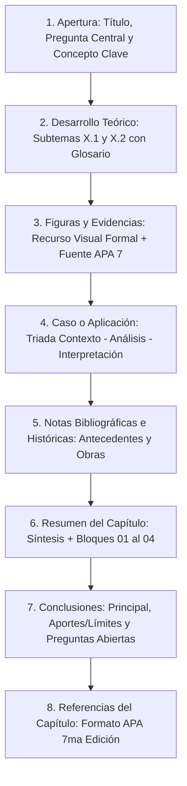

# AGENTS.md: Directrices Editoriales, Normativa APA 7 y Manual Operativo

Este documento constituye la **constitución editorial y operativa** para cualquier agente de inteligencia artificial o colaborador humano que trabaje en la redacción, maquetación, corrección y ensamblaje del libro colectivo de la **Universidad Nacional Mayor de San Marcos (UNMSM)**.

---

## 1. Identidad Institucional y Propósito de la Obra

* **Título General del Libro:** *Inteligencia Artificial Aplicada: Fundamentos, Métodos y Validación Científica*
* **Filiación:** Universidad Nacional Mayor de San Marcos, Facultad de Ciencias Matemáticas.
* **Asignatura:** Inteligencia Artificial Aplicada.
* **Docente Titular:** Frida Mereyda Lopez Cordova.
* **Naturaleza Editorial:** Libro monográfico digital (E-book) estructurado en capítulos temáticos aportados por cada grupo de investigación de la asignatura (Capítulos 1 al 13).
* **Trabajo Base / Benchmark Canónico:** El **Capítulo 12** (elaborado por el Grupo 13) es el modelo patrón indiscutible. Todo nuevo capítulo debe estructurarse y estilizarse siguiendo la calidad, balance visual y rigor metodológico de dicho capítulo.

---

## 2. Invariantes Técnicos y Estilo Visual en LaTeX

El repositorio utiliza LaTeX con compilador `pdflatex` / `xelatex`. Ningún agente debe alterar arbitrariamente los siguientes parámetros maestros definidos en `main.tex`:

### Formato Geométrico y Tipográfico
* **Dimensiones de Página:** Formato A4 vertical (`21.0 cm × 29.7 cm`).
* **Márgenes:** Simétricos de `top=2.5cm, bottom=2.5cm, left=2.5cm, right=2.5cm`.
* **Tipografía de Lectura y Títulos Serif:** `tgtermes` (equivalente de alta fidelidad a *Nimbus Roman* / *Times New Roman*).
* **Tipografía de Metadatos, Etiquetas y Cajas:** `helvet` (equivalente exacto a *Nimbus Sans* / *Helvetica*).
* **Microtipografía:** Paquete `microtype` obligatorio para garantizar una justificación perfecta y evitar palabras huérfanas o particiones silábicas rígidas.
* **Espaciado de Listas:** Todas las listas (`itemize`, `enumerate`) deben respetar `topsep=0.3em, itemsep=0.25em, parsep=0pt, leftmargin=1.5em` para evitar saltos de página involuntarios.

### Paleta Cromática Institucional (UNMSM)
```latex
\definecolor{unmsm_red}{RGB}{133, 45, 58}      % Color vino institucional #852D3A
\definecolor{unmsm_darkred}{RGB}{165, 42, 53}  % Granate San Marcos #A52A35
\definecolor{bg_marfil}{RGB}{251, 247, 239}    % Fondo marfil oficial #FBF7EF
\definecolor{bg_arena}{RGB}{237, 225, 207}     % Fondo arena de soporte #EDE1CF
\definecolor{unmsm_gray}{RGB}{106, 98, 90}     % Gris cálido para lectura secundaria #6A625A
\definecolor{unmsm_gold}{RGB}{200, 190, 176}   % Dorado suave / separadores #C8BEB0
```

### Encabezados y Pies de Página (`fancyhdr`)
* **Encabezado Izquierdo:** `\textcolor{unmsm_red}{\small\sffamily\textbf{\leftmark}}` (sección activa corta).
* **Encabezado Derecho:** `\textcolor{unmsm_red}{\small\sffamily Inteligencia Artificial Aplicada \quad|\quad \textbf{\thepage}}`.
* **Línea de Encabezado:** Regla vino de 0.6 pt (`unmsm_red`).
* **Pie de Página:** Sobrio e institucional, sin duplicar el número de página:
  * Izquierda: *Universidad Nacional Mayor de San Marcos*.
  * Derecha: *Facultad de Ciencias Matemáticas*.

---

## 3. Anatomía Modular Canónica de Cada Capítulo

Todo capítulo integrado al libro debe replicar de manera rigurosa la estructura de **7 componentes pedagógicos** inspirados en la plantilla institucional:



### Detalle de Secciones Requeridas por Capítulo:

1. **Apertura de Capítulo:**
   * Título numerado (`\section[Título Corto]{Título Completo del Capítulo}`).
   * Recuadro beige (`\begin{cajabeige}`) con la **Pregunta Central del Capítulo** y el **Objetivo de Aprendizaje**.
   * Bloque lateral (`\textoside{...}{CONCEPTO CLAVE\\...}`) con la definición clave y su etiqueta enmarcada.
   * **Subtema X.1:** Introducción conceptual, antecedentes directos y justificación con citas formales.

2. **Desarrollo Teórico:**
   * **Subtema X.2:** Explicación técnica detallada del marco metodológico o sistema.
   * Cajas de glosario o notas al pie para términos especializados.
   * **Apartado Específico X.2.1:** Profundización en un aspecto técnico o empírico crítico.

3. **Figuras y Evidencias:**
   * Al menos un recurso visual de alto impacto (diagrama de arquitectura en TikZ, gráfico de barras, esquema metodológico o tabla analítica comparativa).
   * Rótulo formal según APA 7: `\textbf{Figura X.1.}` en negrita, seguido del *Título Descriptivo* en cursiva.
   * Bloque explicativo de interpretación de los datos y procedencia formal (`\scriptsize \textbf{Fuente:} ...`).

4. **Caso o Aplicación Práctica (Subtema X.3):**
   * Debe dividirse explícitamente en la tríada metodológica:
     * `\subsubsection*{Contexto:}` Descripción del escenario real, datos y condiciones experimentales.
     * `\subsubsection*{Análisis:}` Pasos de razonamiento, implementación técnica, pruebas o métricas obtenidas.
     * `\subsubsection*{Interpretación:}` Resultados, lecciones aprendidas, impacto cuantitativo y limitaciones observadas.

5. **Notas Bibliográficas e Históricas:**
   * Sección precedida por `\newpage` y `\markboth{CAPÍTULO X\quad NOTAS BIBLIOGRÁFICAS E HISTÓRICAS}{}`.
   * Describe los orígenes históricos del tema (teorías fundacionales, autores pioneros) y reseña las contribuciones centrales de las fuentes analizadas.
   * Incluye recomendaciones de lecturas complementarias justificadas.

6. **Resumen del Capítulo:**
   * Precedido por `\newpage` y `\markboth{CAPÍTULO X\quad RESUMEN}{}`.
   * Breve párrafo de síntesis global redactado con palabras propias.
   * Lista estructurada `\begin{resumenlist}` con exactamente 4 puntos clave numerados del `01` al `04`:
     * `01:` Idea o principio metodológico central.
     * `02:` Concepto operativo o arquitectura clave.
     * `03:` Evidencia cuantitativa, hallazgo empírico o caso de éxito.
     * `04:` Alcance normativo, gobernanza o limitación crítica.
   * Recuadro final de síntesis en `cajabeige`.

7. **Conclusiones del Capítulo:**
   * Precedido por `\newpage` y `\markboth{CAPÍTULO X\quad CONCLUSIONES}{}`.
   * Dividido obligatoriamente en tres subapartados:
     * `\subsubsection*{Conclusión principal:}` Responde directamente a la Pregunta Central inicial.
     * `\subsubsection*{Aportes y límites:}` Identifica el valor práctico/teórico y delimita con honestidad intelectual las fronteras de aplicabilidad.
     * `\subsubsection*{Preguntas abiertas:}` Formula interrogantes científicas para futuros proyectos o investigaciones.

8. **Referencias del Capítulo:**
   * Lista bibliográfica propia del capítulo en formato APA 7ª edición con sangría francesa (`leftmargin=1.5em, label={}, itemsep=0.35ex, parsep=0pt`).

---

## 4. Política de Citación y Referencias APA 7ª Edición

### Citas en el Texto
* **Citas Narrativas (Énfasis en el autor):** El autor forma parte de la redacción y el año va entre paréntesis:
  * *Un autor:* `Sartori (2025) sostiene que...`
  * *Dos autores:* `Sido y Emon (2024) establecen que...`
  * *Tres o más autores:* Se utiliza **et al.** desde la primera mención: `Marian et al. (2026) demostraron...`
* **Citas Parentéticas (Énfasis en el texto):** Autor y año van juntos entre paréntesis al final de la idea:
  * `(Sido & Emon, 2024)` o `(Marian et al., 2026)`.
* **Citas Secundarias ("Como se citó en"):**
  * Para obras de fondo no disponibles directamente pero citadas en las fuentes primarias:
  * En el texto: `(Royce, 1970, como se citó en Marian et al., 2026)`.
  * En la bibliografía del capítulo: Se incluye la fuente primaria que efectivamente se consultó (`Marian et al., 2026`).
* **Citas Textuales:**
  * Menos de 40 palabras: Entre comillas dobles, dentro del párrafo, señalando la página: `"...texto citado..." (Memari & Rudolph, 2026, p. 14)`.
  * 40 palabras o más: Párrafo en bloque independiente, sin comillas, con sangría izquierda de 1.27 cm y punto antes de la referencia de página.

### Reglas para Figuras y Tablas (APA 7)
* Todas las figuras deben llevar el formato:
  * Línea 1: `\textbf{Figura X.Y}` (en negrita).
  * Línea 2: `\textit{Título descriptivo del recurso visual}` (en cursiva).
  * Contenedor visual (gráfico, diagrama TikZ o imagen nítida).
  * Pie: `\scriptsize \textbf{Nota.} Adaptado de...` o `\scriptsize \textbf{Fuente:} Elaboración propia basada en...`.

---

## 5. Protocolo de Ingesta y Estandarización de Capítulos (Grupos 1 al 11 y 13)

Al procesar los archivos de los demás grupos (ubicados en `Avance de capitulos IA S2/` en formatos `.docx`, `.pdf` o `.pptx`), el agente debe seguir este flujo sin excepción:

1. **Lectura y Mapeo Estructural:** Extraer el texto completo del documento entregado por el grupo e identificar los conceptos, datos empíricos, casos y fuentes originales.
2. **Modularización:** Crear un archivo individual dentro de la carpeta `capitulos/` (ej. `capitulo01.tex`, `capitulo02.tex`, etc.).
3. **Adaptación a las 7 Secciones Canónicas:**
   * Si el documento original carece de "Pregunta Central" o "Concepto Clave", formularlos sintetizando fielmente la propuesta de los autores.
   * Si carece de "Caso Aplicado", identificar el ejemplo empírico, herramienta o caso de uso analizado por el grupo y organizarlo en la tríada **Contexto - Análisis - Interpretación**.
   * Sintetizar las conclusiones en los tres ejes formales (**Principal**, **Aportes/Límites**, **Preguntas Abiertas**).
   * Organizar el resumen en la lista estructurada del **01 al 04**.
4. **Respeto a la Bibliografía Original:** Preservar todas las referencias bibliográficas aportadas por el grupo, convirtiéndolas formalmente al estándar APA 7 (autor, año, título en cursiva, editorial o revista con volumen/número y enlace DOI/URL).
5. **Inclusión en el Maestro:** Añadir `\input{capitulos/capituloXX.tex}` en el lugar correspondiente dentro de `main.tex` y actualizar la tabla de contenidos.

---

## 6. Guardarraíles de Rigor, Calidad y No Alucinación

> [!CAUTION] Prohibición Absoluta de Invención de Contenido
> * **Jamás inventar datos, experimentos, citas o porcentajes.** Todo dato numérico o empírico debe provenir directamente de los documentos entregados por los grupos o de sus fuentes citadas.
> * Si un grupo tiene vacíos argumentales o información incompleta, se debe estructurar lo existente con rigor analítico sin fabricar resultados falsos.
> * Mantener siempre trazabilidad entre las afirmaciones técnicas y sus autores correspondientes.
> * Antes de finalizar cualquier cambio, verificar que el proyecto compile sin errores de sintaxis en LaTeX y confirmar que no se generen páginas semivacías ni líneas huérfanas antes de los saltos de sección (`\newpage`).
